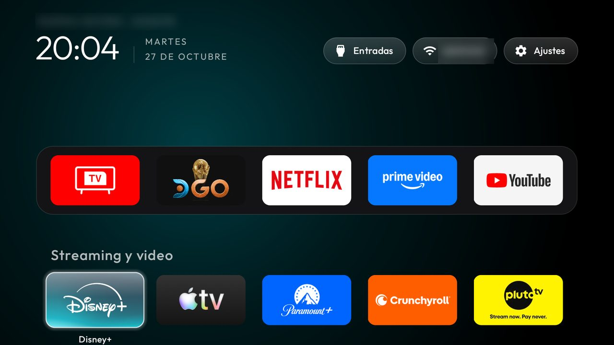

# Limpia mi TV: vista previa de TV en vivo y categorías para TCL BeyondTV

*Este proyecto está documentado primero en español. A short summary in English is at the end.*

Tomé la pantalla de inicio de [cleanyourtv](https://github.com/Gathin23/cleanyourtv) y le agregué tres funciones.
Las probé en mi **TCL BeyondTV con Android TV 11** (firmware AR05, `V8-R851T02-LF1V715`, Latinoamérica,
`TCL-LA-RT2851-S1`, Realtek RTD2851):

- **Vista previa de TV en vivo:** si dejas seleccionado el cuadro de TV en vivo un momento, el último canal de
  antena que viste se reproduce **dentro del cuadro**, con audio. La imagen del cuadro se desvanece y deja ver
  el canal. Al moverte a otro cuadro o abrir una app, se apaga y libera el sintonizador.
- **El cuadro de TV en vivo abre siempre la antena**, aunque la última entrada que usaste haya sido un HDMI.
- **Categorías en la cuadrícula:** títulos como "Streaming y video", "Música" y "Otras", cada categoría en su propia
  fila. La navegación con el control sigue siendo exacta (Arriba/Abajo mueven una fila).



## Cómo funciona

- **El canal:** leo el canal actual del sistema de TV de TCL (`com.tcl.tvmanager.TTvChannelManager`, por reflexión;
  en teles que no lo tienen simplemente se omite) y lo cruzo con la lista de canales de Android por su
  identificador **y por nombre**. Lo hice así porque en la TDT chilena varios canales comparten el mismo
  identificador (MEGA, TV+ y Bío Bío: `1/1/32`). Si no lo encuentra, usa el canal de respaldo
  `live_preview_fallback`: en mi tele es el `7.1`, **TVN HD** (¡aguante la televisión pública de Chile, y
  protejámosla!).
- **El video:** lo dibujo con un `TvView` encima del cuadro. Una capa con la imagen del propio cuadro lo cubre y se
  desvanece cuando el sintonizador avisa que hay video.
- **Sin internet:** el launcher sigue sin permiso de internet. El único permiso que agregué es `READ_TV_LISTINGS`,
  para leer la lista de canales.

Código: [`LivePreview.java`](launcher/app/src/main/java/com/gathin/tvhome/LivePreview.java),
[`CategoryDecoration.java`](launcher/app/src/main/java/com/gathin/tvhome/CategoryDecoration.java) y cambios en
`AppAdapter.java` y `MainActivity.java`. Las opciones están en
[`config.xml`](launcher/app/src/main/res/values/config.xml): `grid_categories`, `live_preview`,
`live_preview_fallback`, `live_preview_delay_ms` y `live_tv_tile_antenna`.

## Instalar

Sigue el [README del proyecto original](README.md) para conectar la tele por ADB. Después, desde esta copia:

```bash
TV_HOST=<ip de la tele> launcher/build-and-install.sh
TV_HOST=<ip de la tele> tools/tv.py 'pm grant com.gathin.tvhome android.permission.READ_TV_LISTINGS'
```

Ajusta `dock_apps`, `grid_categories` y `live_tv_package` en `config.xml` según tu tele. `live_tv_input_id` trae
el sintonizador de la TCL RT2851; en otro modelo déjalo vacío.

## Lo que probé y NO funciona en esta TCL

- **TV en vivo en una ventana flotante sobre otras apps:** no se puede. La tele dibuja el video del sintonizador en
  una sola capa de hardware, por debajo de las apps. Lo probé sobre una app sin video y se escuchaba el audio, pero
  no se veía la imagen. Sobre YouTube, la imagen aparecía en la esquina equivocada y el video de YouTube desaparecía.
- **Reasignar el botón "T" del control (código 4020):** en el firmware AR05 lo maneja la app de TCL
  (`com.tcl.partnercustomizer`), y el aviso `tcl.sys.intent.action.TKey` no llega a otras apps.

---

## English (summary)

> **The full documentation of this project is in Spanish, above.** I built it in Latin America, and Spanish is
> the second most spoken native language in the world, so I wrote it in Spanish first on purpose. This is a short
> summary; for the details, the install steps and the limits I tested, read the Spanish sections (a browser
> translator works well on them).

I took the [cleanyourtv](https://github.com/Gathin23/cleanyourtv) launcher and added three features, tested on my
**TCL BeyondTV, Android TV 11** (AR05 firmware, Latin America, Realtek RTD2851):

- **Live TV preview:** the last antenna channel plays inside the focused Live TV tile, with sound.
- **The Live TV tile always opens the antenna tuner**, not the last input used (e.g. HDMI).
- **Grid categories:** titled groups of apps, each on its own row, with exact D-pad navigation.

No `INTERNET` permission; the only permission I added is `READ_TV_LISTINGS`.

## Autoría

Este repositorio es una copia (fork) de [cleanyourtv](https://github.com/Gathin23/cleanyourtv), porque la pantalla
de inicio necesita el proyecto completo para compilarse. **Lo que hice yo es esto:**

| Archivo | Qué hice |
|---|---|
| [`LivePreview.java`](launcher/app/src/main/java/com/gathin/tvhome/LivePreview.java) | **Nuevo.** La vista previa de TV en vivo dentro del cuadro y la apertura de la antena |
| [`CategoryDecoration.java`](launcher/app/src/main/java/com/gathin/tvhome/CategoryDecoration.java) | **Nuevo.** Los títulos de categoría en la cuadrícula |
| `AppAdapter.java`, `MainActivity.java`, `AndroidManifest.xml` | **Cambios** para conectar mis funciones: agrupar por categoría, navegar con espacios vacíos, abrir la antena y pedir el permiso para leer canales |
| `config.xml` | **Cambios:** las opciones nuevas y la configuración de mi TCL BeyondTV |
| `VISTA-PREVIA-TCL.md`, la portada del `README.md` y su documentación | **Nuevos** |

Todo lo demás (la limpieza de la tele, las herramientas, el resto de la pantalla de inicio y su documentación) es
del proyecto original de [Gathin23](https://github.com/Gathin23) y sus colaboradores. Para ver exactamente qué
cambié, compara mi versión con la original:
[Limpia mi TV vs cleanyourtv](https://github.com/Gathin23/cleanyourtv/compare/main...joaco2v:limpia-mi-tv:main).

## Licencia / License

MIT, como el proyecto original. Basado en [Gathin23/cleanyourtv](https://github.com/Gathin23/cleanyourtv)
(Copyright (c) 2026 Gathin). La vista previa de TV en vivo y las categorías las hice yo
([joaco2v](https://github.com/joaco2v)).
